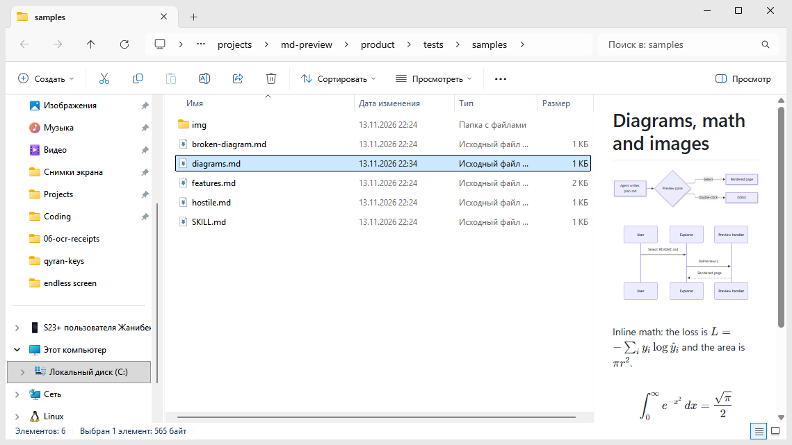
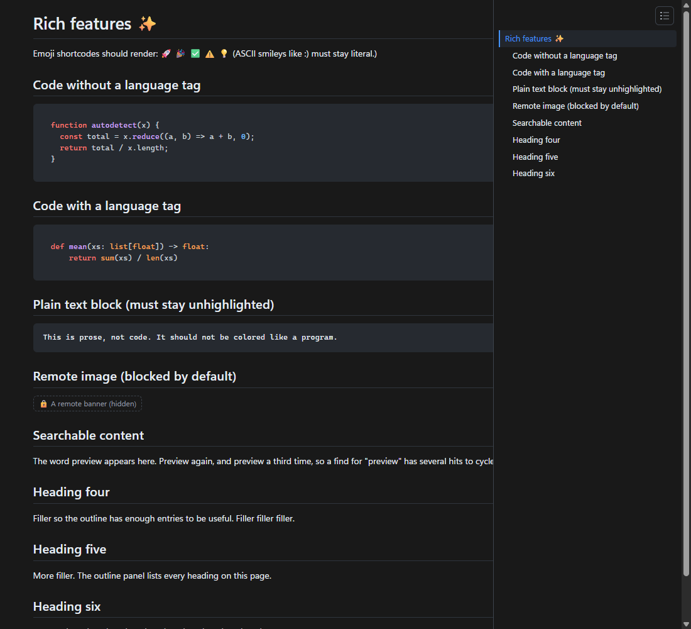

# MdPreview — rich Markdown preview for Windows Explorer

Select a `.md` file in File Explorer, turn on the preview pane (**Alt+P**), and see it **rendered** —
tables, task lists, GitHub alerts, syntax‑highlighted code, **Mermaid diagrams**, **math**, emoji,
a heading outline and **find‑in‑page (Ctrl+F)**. Installs **per‑user, no administrator rights**, and
the preview **never touches the internet**.



## Features

- **Diagrams & math** that the free previewers skip: Mermaid flowcharts/sequence/etc. and KaTeX `$…$` / `$$…$$`.
- **Code** with syntax highlighting (highlight.js), auto‑detecting the language when none is given, plus a Copy button.
- **GitHub‑flavored Markdown**: tables, task lists, `> [!NOTE]`/`[!WARNING]` alerts, footnotes, definition lists,
  strikethrough / `==mark==` / super‑ & subscript, emoji shortcodes (`:rocket:` → 🚀).
- **Navigation**: working in‑document links, a floating **outline** of the headings with scroll‑spy, and **Ctrl+F** find.
- **Front matter** of agent/skill files shown in a collapsible block.
- **Light / dark** following the system theme.
- **Offline & private** by design: a strict Content‑Security‑Policy; no network; scripts in a `.md` never run;
  remote images are blocked and shown as a placeholder (opt‑in toggle).
- **Fast**: a one‑time cache warm‑up at install means the first diagram renders in ~1 s, not ~9 s — and it stays
  fast across reboots.
- Also appears in **classic desktop Outlook**’s attachment preview (same Windows preview‑handler mechanism).



## Install (no admin)

1. Download the latest **`MdPreview-<version>.zip`** from the [Releases](../../releases) page.
2. Unzip it anywhere and double‑click **`Install.cmd`**.
3. In Explorer press **Alt+P** and select a `.md` file.

It installs to `%LOCALAPPDATA%\Programs\MdPreview` and registers under `HKCU` — no administrator rights are used.
`Uninstall.cmd` removes everything. The first run seeds a cache (~15 s, off‑screen); after that it’s fast.

**Requirements:** Windows 10 (1903+) or 11. .NET Framework 4.8 is built in. The Microsoft Edge **WebView2 Runtime**
is needed; it ships with Windows 11 and most Windows 10, and the package installs it per‑user if it’s missing.

## Settings

Remote images are **off by default** (so a preview never fetches from the internet). Toggle them:

```powershell
# in the unzipped folder
powershell -ExecutionPolicy Bypass -File set-remote-images.ps1 -On    # or -Off
```

## Build from source

Requires the .NET SDK and Node (for the pinned front‑end libraries). See **[product/README.md](product/README.md)**
for the full build, test and packaging instructions.

```powershell
cd product
./tools/fetch-vendor.ps1
dotnet build src/MdPreview/MdPreview.csproj -c Release
dotnet build tools/Warmup/Warmup.csproj -c Release
./install/install.ps1
./package/build-package.ps1   # -> package/out/MdPreview-<version>.zip
```

## How it works (short)

A COM preview handler (`IPreviewHandler`, .NET Framework 4.8) that Explorer loads into `prevhost.exe`. It renders
Markdown to HTML with [Markdig](https://github.com/xoofx/markdig) and shows it in WebView2, serving the page and
bundled libraries from memory over a fake local host with a strict CSP. Bundled libraries are served cacheable so
WebView2 persists their compiled bytecode to disk, which is what keeps diagrams fast. Details in
[product/README.md](product/README.md).

## Status

Working prototype, tested on Windows 11 x64 (WebView2 157). Not code‑signed; packaging for the Microsoft Store and
winget are future steps. Contributions and issues welcome.

## Third‑party & license

MdPreview is released under the [MIT License](LICENSE). It bundles Markdig (BSD‑2), the Microsoft Edge WebView2 SDK,
Mermaid (MIT), KaTeX (MIT) and highlight.js (BSD‑3); see [product/LICENSES.md](product/LICENSES.md).

## Support

MdPreview is free and open‑source. If it saves you time, a ⭐ on the repo is appreciated — and issues and
pull requests are welcome.
