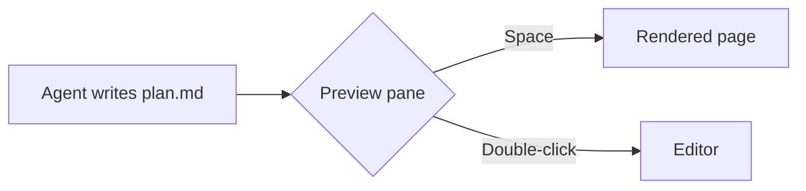
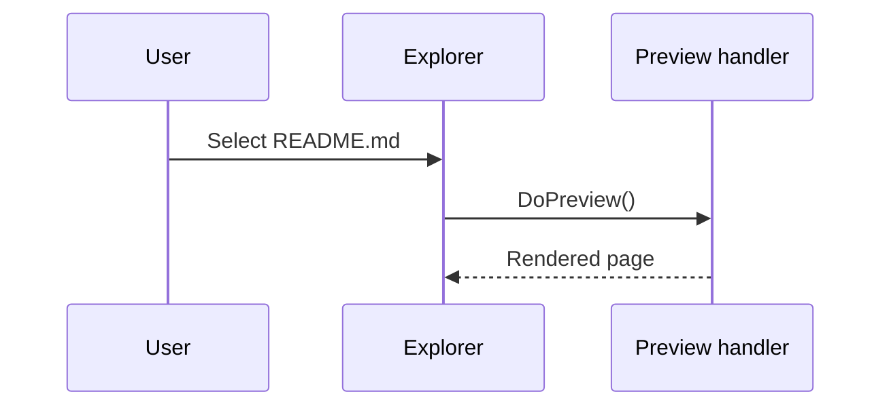
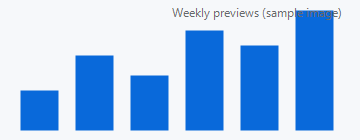

# Release notes · v2.4

Everything a typical README or agent plan uses. **Bold**, *italic*, ~~strikethrough~~, `inline code`, <kbd>Ctrl</kbd>+<kbd>C</kbd> and a [link](https://example.com).

> [!NOTE]
> GitHub-style alerts are rendered as callouts.

> [!WARNING]
> Back up the database before you migrate.

## Checklist

- [x] Parse the spec
- [x] Write migrations
- [ ] Update the docs
  - [ ] API reference
  - [x] Changelog

## Comparison

| Feature | Free viewer | This preview |
|:--|:--:|--:|
| Tables | ✓ | ✓ |
| Mermaid | — | ✓ |
| Math | — | ✓ |
| Works offline | ✓ | ✓ |

## Code

```csharp
public static int Fibonacci(int n) => n < 2 ? n : Fibonacci(n - 1) + Fibonacci(n - 2);
```

```python
def handler(event: dict) -> dict:
    """Return the order total with tax."""
    total = sum(item["price"] * item["qty"] for item in event["items"])
    return {"total": round(total * 1.12, 2)}
```

```json
{ "name": "md-preview", "version": "0.1.0", "private": true }
```

## Diagram





## Math

Inline: the loss is $L = -\sum_i y_i \log \hat{y}_i$ and the area is $\pi r^2$.

$$
\int_0^\infty e^{-x^2}\,dx = \frac{\sqrt{\pi}}{2}
$$

## Local image



## Кириллица и эмодзи

Предпросмотр должен показывать русский текст без «кракозябр». Emoji: 🚀 ✅

<details>
<summary>Raw HTML: details block</summary>

Hidden content appears when expanded.

</details>

Term
: Definition lists work too.

Footnotes are supported.[^1]

[^1]: This is the footnote text.
