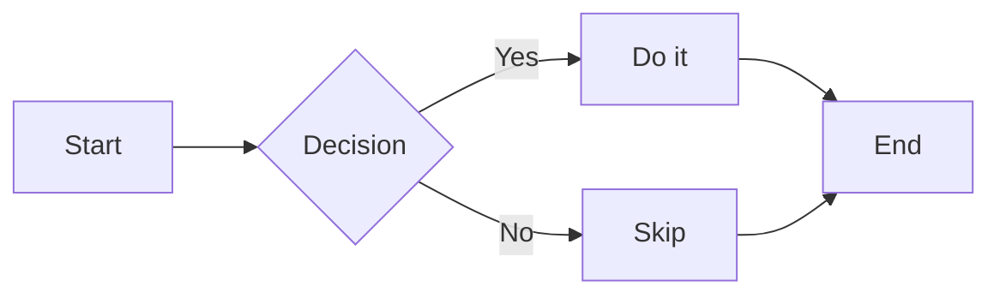
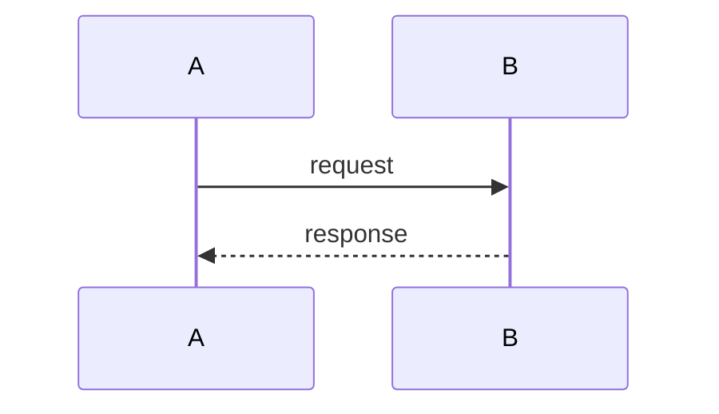
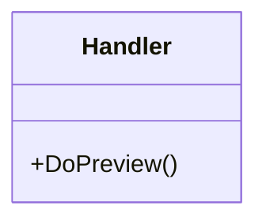
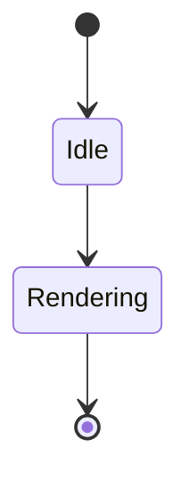
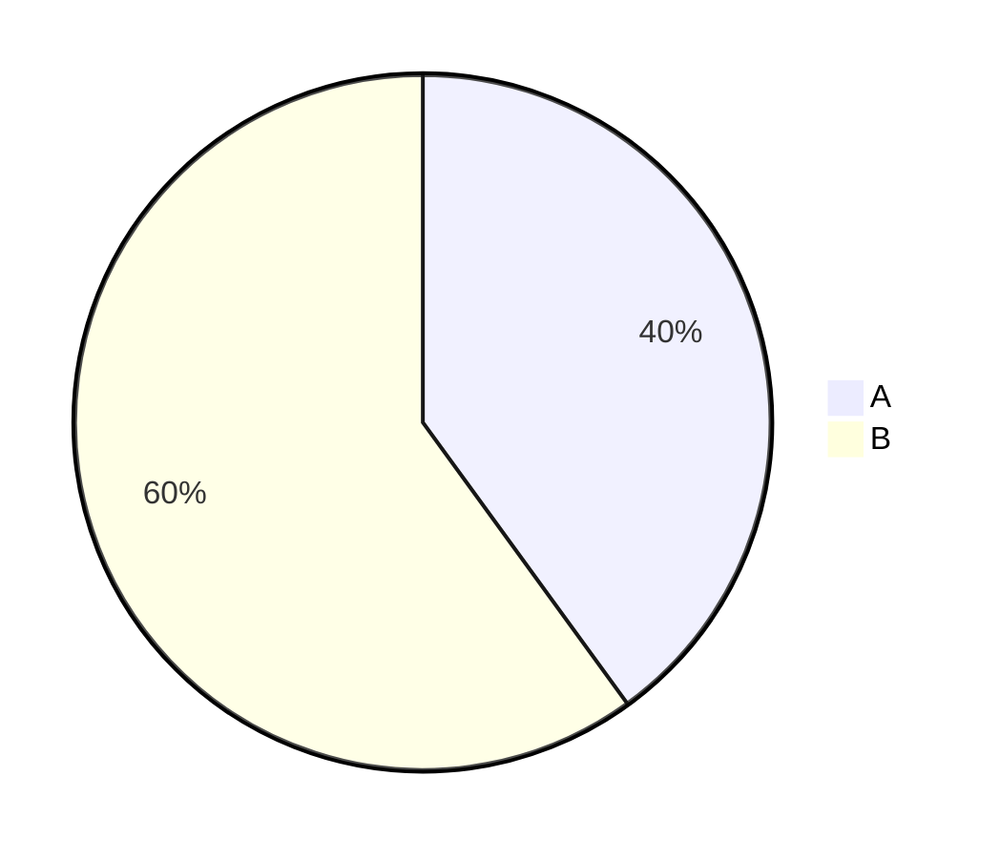
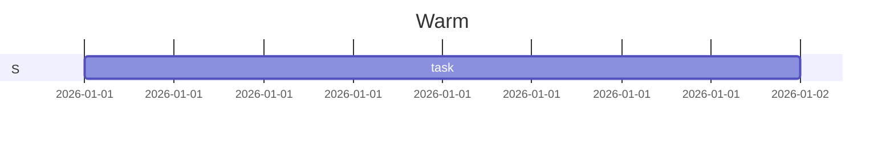

# Warm-up

Seeds the V8 code cache so the first real diagram is fast. Covers the heaviest scripts:
Mermaid (flowchart + sequence), KaTeX math, and highlight.js.













Inline math $e^{i\pi} + 1 = 0$ and a display block:

$$
\sum_{k=1}^{n} k = \frac{n(n+1)}{2}
$$

```python
def warm(x: int) -> int:
    return sum(range(x))
```

```javascript
const warm = (x) => [...Array(x).keys()].reduce((a, b) => a + b, 0);
```
